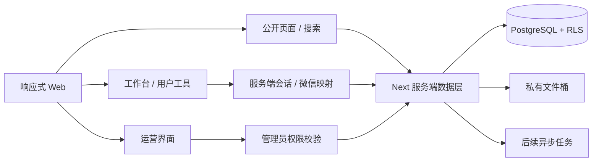

# 上岸有期 · 架构与交付规划

## 依据与当前边界

本轮用户指令优先；`PRD.md` 保留原始附件（文件名 V1.4，内部标题 V1.3，含 V1.4 增补），`prototype.html` 仅作信息架构与交互参考。`public/logo.png` 是交付包原始品牌资产，未替换或重绘。

当前交付 Sprint 0–1 公开前端，并提前完成 Sprint 2 的本地工作台纵向交互；不是生产平台。未连接 Supabase、微信、OpenAI、支付、第三方采集或真人服务。浏览器存储不是身份认证，也不能证明账号隔离或跨设备同步。

## 推荐系统架构

- Next.js App Router + TypeScript：页面、布局、服务端 Route Handlers；公开内容后续使用服务端数据库查询，避免在浏览器暴露管理密钥。
- Tailwind CSS v4 + 设计 token：统一黑白和克制辅助色；个人主题限定在工作台。
- shadcn/ui 兼容的 Button（Radix Slot、CVA、cn），逐步扩展可访问组件，不一次引入全部组件。
- Supabase PostgreSQL：公共岗位、公司别名、用户工作台、内容及业务模型；Auth 和 Storage 作为后续基础服务。
- 权限：服务端认证与角色检查 + PostgreSQL RLS。私有文件使用私有桶与短时签名链接，管理员不天然读取私人简历或录音。
- 微信 OAuth：官方开放平台网站应用 → 服务端生成不可预测 state 并写入 HttpOnly/Secure/SameSite Cookie → 官方授权 → 服务端校验 state、有效期与单次使用 → 交换 code → provider_identity 映射内部用户 ID → 轮换自身会话。当前 API 固定返回 503，无假二维码，无默认测试管理员。
- 搜索：当前纯函数数据适配器；后续数据库直接匹配 + 人工审核的公司别名/岗位词典扩展，精确模式不扩展。公共内容必须先做发布状态过滤；分页、去重、排序在查询层统一实现。
- 异步任务（后续）：授权内容连接器、音频转写、AI 建议、提醒。服务端队列提供限额、超时、幂等、成本控制。
- 部署：Vercel 或 Node.js 容器 + 托管 Supabase。正式公开前独立完成隐私、内容来源、招聘服务及商业化核查。

## 完整路由规划

| 路由                                           | 用途                                         | 本轮状态 / 最终权限     |
| ---------------------------------------------- | -------------------------------------------- | ----------------------- |
| `/`                                            | 品牌首页、四分类、精选岗位、工具入口         | 已实现 / 公开           |
| `/jobs`                                        | 四类岗位、城市、行业、届别、关键词、排序分页 | 已实现演示 / 公开       |
| `/jobs?type=日常实习`                          | 日常实习分类                                 | 已实现                  |
| `/jobs?type=转正实习`                          | 明确留用证据的实习                           | 已实现                  |
| `/jobs?type=秋招`、`?type=春招`                | 校招分类                                     | 已实现                  |
| `/jobs/[id]`                                   | JD、邮箱/标题、来源、加入工作台              | 已实现演示 / 公开       |
| `/search?q=&mode=`                             | 全站模糊/精准搜索与结果分类                  | 已实现演示 / 公开       |
| `/login`                                       | 微信官方扫码入口与演示入口                   | 已实现未开通状态        |
| `/api/auth/wechat`                             | 授权发起                                     | 已预留，固定 503        |
| `/auth/wechat/callback`                        | 官方 OAuth 回调                              | 已预留，关闭处理        |
| `/account`                                     | 资料、头像、数据删除、登录状态               | 本地演示 / 本人         |
| `/workspace`                                   | 横向表格、状态、个性化、视图预览             | 已实现本地演示 / 本人   |
| `/workspace/[id]`                              | 多工作台                                     | 后续 / 本人             |
| `/resume`                                      | 简历工具范围预览                             | 已实现开发中页 / 本人   |
| `/resume/[id]`、`/resume/[id]/versions`        | 简历编辑与版本                               | 后续 / 本人             |
| `/review`                                      | 本地文字复盘、保存查看删除                   | 已实现本地演示 / 本人   |
| `/review/[id]`                                 | 关联投递的复盘与报告                         | 后续 / 本人             |
| `/interviews`、`/interviews/[id]`              | 原创准备示例、筛选、阅读                     | 已实现示例 / 公开或授权 |
| `/radar`                                       | 授权数据源/索引规划                          | 已实现开发中页          |
| `/radar/subscriptions`                         | 关键词订阅                                   | 后续 / 本人             |
| `/store`                                       | 原创/授权资料商城预览                        | 已实现开发中页          |
| `/store/[id]`、`/orders`、`/orders/[id]`       | 商品、订单、内容权限与退款                   | 后续 / 本人             |
| `/mock`                                        | 虚构导师、方向筛选、本地预约意向             | 已实现原型              |
| `/mock/[id]`、`/mock/bookings/[id]`            | 真实导师介绍/预约                            | 后续 / 提交需登录       |
| `/mentor`、`/mentor/availability`              | 面试官工作台、排期反馈                       | 后续 / 已核验导师       |
| `/calendar`                                    | 本地投递时间线，明确未经核验                 | 已实现演示 / 本人       |
| `/admin`                                       | 运营总览、安全登录状态                       | 已实现关闭状态 / 管理员 |
| `/admin/jobs`、`/admin/import`                 | JD 管理/导入                                 | 入口已预留，写操作关闭  |
| `/admin/content`、`/admin/dictionaries`        | 内容来源/词典管理                            | 入口已预留，写操作关闭  |
| `/admin/mock`、`/admin/orders`、`/admin/audit` | 导师资质、订单、审计                         | 后续 / 管理员           |
| `/privacy`、`/terms`                           | 隐私与服务协议                               | 正式发布前完成          |

未实现路由不伪装成业务成功页，未知 URL 返回 404。后台子入口当前统一展示管理能力边界，不声称已完成 CRUD。

## 核心数据库设计

初始迁移见 `supabase/migrations/0001_foundation.sql`，尚未在真实 Supabase 实例执行。内部 ID 使用 UUID；所有私人资源关联 `auth.users.id`。用户投递状态和岗位发布状态是两套独立模型。

| 模型                                                     | 关键关系与约束                                                                               |
| -------------------------------------------------------- | -------------------------------------------------------------------------------------------- |
| profiles / user_roles                                    | 用户资料 / 服务端管理的角色；用户不能自行提升权限                                            |
| provider_identities                                      | 内部用户对微信 appid + openid 唯一映射，不假定 unionid 一定返回                              |
| companies / company_aliases                              | 公司与已审核别名；别名不自动跨公司合并                                                       |
| job_synonyms                                             | 可审核岗位词典；精准检索不使用扩展                                                           |
| jobs                                                     | 四种招聘类型、五种发布状态、JD、申请链接、来源、核验时间；转正实习必须有 possible + 留用证据 |
| job_application_contacts                                 | 一岗多个邮箱，不能以邮箱作为岗位去重主键                                                     |
| job_audit_logs                                           | 管理动作、操作者、时间、前后变化；不可写敏感私人内容                                         |
| workspaces / workspace_statuses                          | 一用户多工作台；状态名、颜色、顺序可自定义                                                   |
| application_records                                      | 所属工作台、岗位可空、公司/岗位快照、城市、渠道、邮箱、日期、状态、备注；外部岗位可手动录入  |
| workspace_fields / workspace_preferences                 | 字段类型、顺序、列宽、显隐、封面、主题、名称；支持不同工作台独立配置                         |
| favorites                                                | 用户与岗位联合唯一                                                                           |
| resume_versions / interview_reviews                      | 私人简历与复盘，关联投递；版本与音频分别删除                                                 |
| interview_posts / content_sources / rights_records       | 原创、授权、外部索引；来源、授权范围与失效状态                                               |
| radar_subscriptions                                      | 用户关键词、来源、公司岗位关联与提醒偏好                                                     |
| mock_interviewers / mock_availability / mock_requests    | 核验导师、排期、意向；材料共享需独立 consent                                                 |
| products / orders / order_items / refunds / entitlements | 商品与授权来源、订单、退款与访问权限；本轮没有支付接口                                       |
| calendar_events / notification_preferences               | 手动日程或投递派生日期、核验标识、提醒设置                                                   |
| sharing_consents / deletion_requests                     | 明确的数据共享、撤销与账号注销处理                                                           |

后续迁移扩充业务模型，不能只建表就宣布功能完成。上线前必须以两个真实测试账号及管理员运行 RLS/服务端 API 越权测试；需要额外验证关联记录的所有者一致性。

## 可复用 UI 组件

- Shell、官方 Logo、桌面导航、移动折叠菜单、Footer、跳至正文。
- Button（CVA/Radix Slot）、图标按钮、表单输入/选择器、模式开关、TabList。
- PageHeading、DemoNote、JobCard、CompanyMark、Tag、收藏按钮、CopyButton。
- 来源与核验区、留用证据区、同页投递信息区。
- 横向表格、冻结公司/岗位列、行内编辑、状态 Select、删除确认、状态色彩编辑、列显隐。
- 工作台封面/主题、自动保存状态、CSV 导出、看板与时间线预览。
- Modal、Empty、加载骨架、ErrorBoundary、404、成功/失败提示。
- 原创示例文章卡片、MentorCard、预约意向表单、PendingModule、管理员关闭状态。

## Sprint 0–2 详细任务与验收

### Sprint 0：底座与视觉

- [x] 导入原始 PRD、HTML 与 Logo；识别附件版本差异。
- [x] Next App Router、严格 TypeScript、Tailwind v4、锁文件和基础 UI 组件。
- [x] 色彩/边框/间距/圆角 token、响应式导航、布局与 Footer。
- [x] 明确演示数据、业务空态、错误页、404 与加载骨架。
- [x] 全模块入口与可扩展目录；架构/路由/数据库/任务文档。
- [ ] 部署目标环境与真实服务凭证配置（非当前样品前置条件）。

### Sprint 1：公开浏览

- [x] 首页、四类岗位、城市/行业/届别筛选、排序与分页。
- [x] JD 职责/要求/出勤/留用原文/投递邮箱及主题/官网来源整合。
- [x] 模糊与精准模式、公司别名、岗位同义词、结果分类及空态。
- [x] 本地收藏、加入工作台、重复添加提示；点击外链不改变投递状态。
- [x] 微信页面和关闭的服务端授权入口；个人资料本地演示。
- [x] 面经原创示例、Mock 意向、未来模块开发中页。
- [ ] 真正公开内容管理与 Supabase 数据适配器（按本轮指令放到 Sprint 3）。
- [ ] 精确匹配规则、别名歧义和内容来源的运营维护。

### Sprint 2：工作台

- [x] 默认横向表格，冻结两列，直接编辑，日期选择，手动新增、复制、删除二次确认。
- [x] 自定义状态新增、改名、调色、删除后记录迁移。
- [x] 搜索、状态筛选、公司/日期排序、CSV 导出。
- [x] 自定义名称、主题、内置/本地上传封面；自动保存与失败提示。
- [x] 表格/看板/时间线共享本地数据源（辅助视图预览）。
- [x] 列显隐基础交互。
- [ ] 字段类型扩展、列排序/宽度调整、批量粘贴、CSV 导入。
- [ ] 多工作台创建与切换。
- [ ] Supabase Auth、跨设备持久化、私有文件访问和完整 RLS 验证。
- [ ] 受控的服务端开发测试认证，禁止生产环境使用模拟管理员。
- [ ] 微信资质批准后完成官方 OAuth 与会话安全。

验收按实际验证结果记入 README；本地演示不替代用户隔离测试。后续业务依赖由数据适配层接入，保留全部核心模块，不一次生成不可验证的生产能力。
